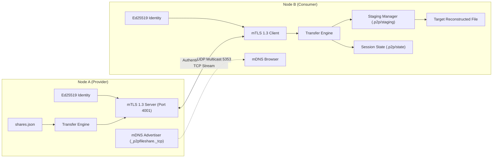

# Decentralized Peer-to-Peer (P2P) File Sharing System

A high-performance, resilient, and cryptographically verified peer-to-peer file sharing application built with Go 1.24+.

Designed without central coordination or single points of failure, this system implements mutual TLS 1.3 transport security, persistent Ed25519 cryptographic identities, local network auto-discovery via mDNS, chunk-level integrity verification, and crash-resilient session resumption with 0% redundant re-downloads.

---

## Key Features

- **Decentralized 1:1 Direct Transfer**: High-throughput chunk streaming directly between provider and consumer peers over stream-oriented TCP.
- **Cryptographic Node Identity**: Each node generates and maintains a persistent Ed25519 identity keypair, serving as its permanent, unforgeable 64-character hex `PeerID`.
- **Zero-Trust Mutual TLS 1.3**: All communication is secured via mTLS 1.3 using ephemeral session keys (ECDHE) for perfect forward secrecy. Connection establishment cryptographically verifies remote peer identities.
- **Strict Content Integrity**: Files are deterministically partitioned into 512 KB chunks. Each chunk is verified against its manifest SHA-256 digest upon arrival, and assembled files undergo final whole-file SHA-256 verification before completion.
- **Hybrid Peer Discovery**:
  - **Local Subnet (mDNS)**: Automatically broadcasts and discovers peers using `_p2pfileshare._tcp.local.`.
  - **Direct Endpoint Fallback**: Manual connection via `IP:Port` for cross-subnet or isolated network setups.
- **Resilient Transfer & Instant Resume**: Verified chunks are committed to disk staging (`.p2p/staging/<file_id>/<index>.chunk`) alongside persistent bitfield state (`.p2p/state/<file_id>.json`). Interrupted downloads resume by requesting only missing chunks (0% re-download).
- **Standard UNIX CLI Contract**: Clean separation of streams (`stdin` input, `stdout` text/`--json`, `stderr` diagnostic logs) with standardized exit codes (0 to 4).

---

## Architecture Overview



### Wire Protocol Framing

Every frame sent over the established TLS 1.3 channel uses a 5-byte length-prefixed binary header:

```text
 0                   1                   2                   3
 0 1 2 3 4 5 6 7 8 9 0 1 2 3 4 5 6 7 8 9 0 1 2 3 4 5 6 7 8 9 0 1
+-+-+-+-+-+-+-+-+-+-+-+-+-+-+-+-+-+-+-+-+-+-+-+-+-+-+-+-+-+-+-+-+
|                       Payload Length                          | (4 bytes, Big-Endian uint32)
+-+-+-+-+-+-+-+-+-+-+-+-+-+-+-+-+-+-+-+-+-+-+-+-+-+-+-+-+-+-+-+-+
|  Message Type |               Payload Data ...                |
+-+-+-+-+-+-+-+-+                                               |
```

| Opcode | Name | Description |
|---|---|---|
| `0x01` / `0x02` | `Ping` / `Pong` | Heartbeat keep-alive probe and response |
| `0x10` / `0x11` | `ManifestRequest` / `ManifestResponse` | Manifest query by 32-byte File ID and JSON response |
| `0x20` / `0x21` | `ChunkRequest` / `ChunkResponse` | Binary chunk payload fetch with index and checksum |
| `0x30` | `ErrorMessage` | Structured error notification (code + string) |

---

## Build & Installation

### Requirements
- **Go**: Version 1.24 or higher
- **OS**: Windows, Linux, or macOS

### Compilation
Compile the binary directly from source:

```bash
# Clone or enter the project directory
cd p2p-file-sharing

# Build the binary
go build -o p2p.exe ./cmd/p2p

# Verify execution
./p2p.exe
```

---

## Panduan Uji Coba Manual (Step by Step)

Untuk melakukan simulasi transfer file antara dua node mandiri di komputer lokal, buka **dua jendela terminal** (misalnya Terminal 1 untuk Provider dan Terminal 2 untuk Consumer).

### Skenario 1: Direct 1:1 File Transfer (User Story 1)

#### Langkah 1: Inisialisasi Identitas Kedua Node

Di **Terminal 1** (Node A - Provider):
```powershell
.\p2p.exe init --data-dir .nodeA
```
*Output*:
```text
Initialized new node identity.
Peer ID: <64-character-hex-peer-id>
Config saved to: .nodeA\identity.json
```

Di **Terminal 2** (Node B - Consumer):
```powershell
.\p2p.exe init --data-dir .nodeB
```
*Output*:
```text
Initialized new node identity.
Peer ID: <64-character-hex-peer-id>
Config saved to: .nodeB\identity.json
```

---

#### Langkah 2: Buat Berkas Uji & Bagikan (Share) dari Node A

Di **Terminal 1**:
```powershell
# Buat file pengujian sebesar 10 MB (10.485.760 bytes)
fsutil file createnew sample.dat 10485760

# Publikasikan file ke jaringan lokal menggunakan Node A
.\p2p.exe share sample.dat --data-dir .nodeA
```

*Output*:
```text
File published successfully.
File Name:   sample.dat
File Size:   10485760 bytes (10.0 MB)
File ID:     a1b2c3d4e5f6... (catat 64 karakter File ID ini)
Chunk Count: 20 (524288 bytes each)
Share Token: a1b2c3d4e5f6...
```

---

#### Langkah 3: Jalankan Daemon Node A (Provider)

Di **Terminal 1**, jalankan daemon agar Node A siap melayani permintaan unduhan:
```powershell
.\p2p.exe start --port 4001 --data-dir .nodeA
```

*Output*:
```text
Node daemon running on port 4001.
Peer ID: <Peer-ID-Node-A>
mDNS local discovery active.
Press Ctrl+C to terminate.
```

---

#### Langkah 4: Unduh Berkas dari Node B (Consumer)

Buka **Terminal 2**, lalu jalankan perintah download dengan menyertakan `File ID` dari Langkah 2:
```powershell
.\p2p.exe download --file-id <PASTE_FILE_ID_DISINI> --peer 127.0.0.1:4001 --data-dir .nodeB --output-dir downloads
```

*Output*:
```text
Connecting to peer 127.0.0.1:4001 over encrypted channel... Connected.
Downloading chunks: 20/20 (100.0%)
Post-assembly SHA-256 verification: MATCH
File saved to: downloads\<FILE_ID>.bin (Transfer Completed)
```

---

#### Langkah 5: Buktikan Rekonstruksi Bit-Exact (SHA-256)

Di **Terminal 2**, bandingkan hash SHA-256 berkas sumber dengan berkas yang baru diunduh:
```powershell
# Hash file asli
certutil -hashfile sample.dat SHA256

# Hash file hasil unduhan
certutil -hashfile downloads\<FILE_ID>.bin SHA256
```
Kedua hash SHA-256 dijamin **100% identik**.

---

### Skenario 2: Uji Resiliensi & Resume Otomatis (User Story 2)

Skenario ini membuktikan bahwa jika koneksi terputus di tengah proses unduh, chunk yang sudah terverifikasi tidak akan diunduh ulang (0% redundant re-download).

1. Buat file baru berukuran 20 MB:
   ```powershell
   fsutil file createnew big_sample.dat 20971520
   .\p2p.exe share big_sample.dat --data-dir .nodeA
   ```
2. Jalankan unduhan di Terminal 2:
   ```powershell
   .\p2p.exe download --file-id <FILE_ID_BARU> --peer 127.0.0.1:4001 --data-dir .nodeB --output-dir downloads
   ```
3. Tekan `Ctrl+C` di Terminal 2 saat progress mencapai sekitar 40-50%.
4. Periksa status sesi unduhan yang terinterupsi:
   ```powershell
   .\p2p.exe status --data-dir .nodeB
   ```
   *Status akan menampilkan: `Interrupted` dengan jumlah chunk yang sudah tersimpan di staging.*
5. Jalankan kembali perintah unduh yang sama:
   ```powershell
   .\p2p.exe download --file-id <FILE_ID_BARU> --peer 127.0.0.1:4001 --data-dir .nodeB --output-dir downloads
   ```
   *Node B langsung melanjutkan dari chunk yang belum tersimpan tanpa mengunduh ulang chunk awal.*

---

### Skenario 3: Penemuan Peer (mDNS & Manual)

Periksa peer yang terdaftar di jaringan:
```powershell
.\p2p.exe peers --data-dir .nodeB
```

Menambahkan endpoint peer secara manual:
```powershell
.\p2p.exe peers --data-dir .nodeB --add 192.168.1.50:4001
```

Mendapatkan output terstruktur dalam format JSON di semua perintah CLI:
```powershell
.\p2p.exe status --data-dir .nodeB --json
.\p2p.exe peers --data-dir .nodeB --json
---

## Web UI Dashboard & Real-Time Visualization

P2P File Sharing menyertakan dashboard antarmuka web modern yang langsung di-embed ke dalam binary Go executable tunggal melalui `//go:embed`. Tidak diperlukan dependensi eksternal seperti Node.js atau npm pada sistem host.

### Fitur Utama Web Dashboard:
- **BitTorrent-Style Live Chunk Grid Visualizer**: Visualisasi matriks blok chunk secara langsung saat berkas diunduh.
  - **Abu-abu (Slate 700)**: Chunk antre (`Pending`).
  - **Biru Berkedip (Blue 500 Pulse)**: Sedang diambil dari peer (`Fetching`).
  - **Hijau Pop (Emerald 500)**: Checksum SHA-256 terverifikasi dan tersimpan (`Verified`).
  - **Merah Goyang (Red 500 Shake)**: Checksum rusak, otomatis di-request ulang (`Corrupt`).
- **Low-Latency Telemetry (Server-Sent Events)**: Telemetri progres, kecepatan transfer (MB/s), dan pembaruan chunk secara real-time via endpoint SSE `/api/events` (< 100ms latensi).
- **Drag-and-Drop File Publishing**: Tarik dan lepas berkas ke dropzone untuk menghitung digest SHA-256 dan membagikan token secara instan.
- **Manajemen Peer**: Daftar peer yang ditemukan via mDNS lokal serta modal untuk menambahkan endpoint peer manual.
- **Kontrol Sesi Transfer**: Tombol Pause dan Resume unduhan secara interaktif dengan retensi bitfield 100% (0% re-download).
- **Desain Ergonomis (ui-ux-pro-max)**: Tema Developer Dark Theme (Slate 900 latar, Slate 800 cards, kontras WCAG AA 4.5:1, tipografi Inter, dan rendering angka tabular monospace).

### Mengakses Web Dashboard:
Saat daemon dijalankan (`p2p start`), server web otomatis aktif di port `8080`:
```powershell
.\p2p.exe start --port 4001 --web 8080
```
Buka peramban (browser) di alamat:
👉 **`http://localhost:8080`**

Untuk mengubah port web server atau menonaktifkannya:
```powershell
# Menggunakan port web khusus (misal 9090)
.\p2p.exe start --port 4001 --web 9090

# Menjalankan daemon murni tanpa web server
.\p2p.exe start --port 4001 --no-web
```

---

## Standar Kode Keluar (Exit Codes)

Aplikasi mengikuti standar kode keluar UNIX yang deterministik:

| Exit Code | Nama | Deskripsi |
|---|---|---|
| `0` | `ExitSuccess` | Perintah berhasil dieksekusi tanpa galat |
| `1` | `ExitRuntime` | Galat umum saat runtime (I/O berkas, alokasi memori) |
| `2` | `ExitValidation` | Argumen tidak valid, manifest rusak, atau ukuran file di luar batas (1 KB hingga 2 GB) |
| `3` | `ExitNetwork` | Port bentrok, peer tidak terjangkau, atau timeout koneksi |
| `4` | `ExitIntegrity` | Ketidakcocokan checksum SHA-256 pada chunk atau file utuh |

---

## Verifikasi Kualitas & Test Suite

Proyek ini dikembangkan secara ketat menggunakan prinsip Test-Driven Development (TDD) dengan target cakupan kode tinggi.

### Menjalankan Semua Pengujian
```bash
# Menjalankan seluruh pengujian unit dan integrasi
go test -v ./pkg/... ./tests/...

# Menjalankan pemeriksaan static analysis
go vet ./...
```

---

## Struktur Direktori Proyek

```text
p2p-file-sharing/
├── cmd/
│   └── p2p/
│       └── main.go              # Entrypoint aplikasi CLI
├── pkg/
│   ├── cli/                     # Subperintah CLI (init, share, download, status, peers, start)
│   ├── discovery/               # Discovery mDNS (zeroconf) dan tabel PeerRegistry
│   ├── identity/                # Kriptografi identitas node Ed25519 dan serialisasi
│   ├── manifest/                # Partisi 512 KB chunk, FileManifest, dan validator matematis
│   ├── protocol/                # Wire protocol framing (header 5-byte) dan opcode encoder/decoder
│   ├── transfer/                # TransferEngine, StagingManager, SessionManager, dan HeartbeatMonitor
│   └── transport/               # Mutual TLS 1.3, X.509 self-signed certs, dan TCP listeners
├── specs/
│   └── 001-decentralized-file-sharing/
│       ├── spec.md              # Spesifikasi kebutuhan fungsional & non-fungsional
│       ├── plan.md              # Rencana teknis arsitektur
│       ├── tasks.md             # 40 daftar tugas implementasi TDD
│       ├── data-model.md        # Entitas data & diagram state machine
│       ├── contracts/           # Kontrak CLI dan protokol kawat
│       └── quickstart.md        # Panduan validasi skenario pengujian
├── tests/
│   ├── harness/                 # In-memory network pipe simulation harness
│   ├── integration/             # E2E integration tests (50MB transfer, resume, mDNS)
│   └── testdata/                # Fixture manifest uji validasi
├── go.mod
└── README.md
```
